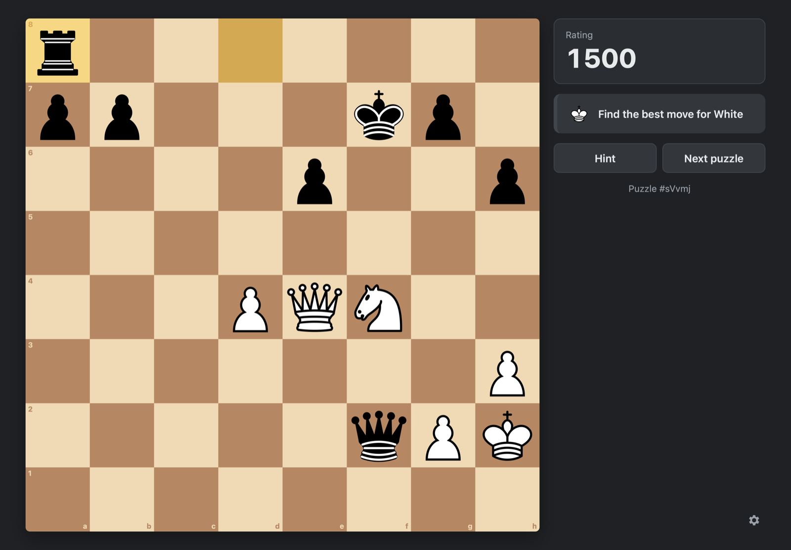

# Stalemate

Offline chess puzzles and a chess bot for Windows, macOS and Linux, built with Tauri 2 (Rust) and TypeScript.



**[Download Stalemate](https://github.com/yaotz1n/stalemate/releases/latest)** for Windows, macOS or Linux.

## Puzzle data

Puzzles come from the [Lichess puzzle database](https://database.lichess.org/#puzzles) (CC0). The app ships
`data/puzzles.db`, a filtered set of about 128k puzzles (28 MB) spread evenly across ratings 400–3000. To rebuild it:

```bash
curl -LO --output-dir data/raw https://database.lichess.org/lichess_db_puzzle.csv.zst
python3 tools/build_puzzle_db.py data/raw/lichess_db_puzzle.csv.zst
```

Options: `--target` (puzzle count, `0` = every puzzle that passes the filters, about 2.9M), `--min-popularity`,
`--min-plays`, `--max-rd`. `.zst` input needs `zstd` on PATH.

Each puzzle's FEN is the position *before* the opponent's move: `moves[0]` is played automatically, then the player
must find `moves[1]`, the opponent replies with `moves[2]`, and so on. Any checkmating move is accepted.

## The bot

*Computer* mode runs a small chess engine written for this app (`src-tauri/src/engine/`, no outside code). It adds
little to the app's size and uses about 3 MB of memory while thinking (mostly its transposition table). It's an alpha-beta search (iterative deepening,
quiescence search, transposition table, null-move pruning, late-move reductions, killer/history ordering) over a
tapered PeSTO piece-square evaluation, with a mop-up term for converting won endgames.

| Level | Search | Mistakes |
|---|---|---|
| 1 Beginner | 1 ply | picks among moves up to ~3.5 pawns worse than the best |
| 2 Casual | 2 ply | up to ~1.8 pawns worse |
| 3 Club | 3 ply | up to ~0.9 pawns worse |
| 4 Strong | 5 ply, 0.6 s | up to ~0.3 pawns worse |
| 5 Expert | up to 1.5 s | none (some variety in the first moves) |

Weaker moves are picked less often the worse they are, and every level always plays a mate it can see. In the
browser preview (`npm run dev`) a much weaker stand-in (`src/previewBot.ts`) plays instead, since the Rust engine
only runs in the desktop app. Engine tests (perft against the standard reference counts, mates, timing):

```bash
cd src-tauri && cargo test --release --lib engine
```

An unfinished game is saved after every move and comes back when the app reopens. Takebacks are allowed, including
after the game ends.

## Layout

| Path | What |
|---|---|
| `src-tauri/src/store.rs` | SQLite access: read-only `puzzles.db` + per-user `user.db` (attempts, rating, settings) |
| `src-tauri/src/glicko2.rs` | Glicko-2 rating updates (player vs. puzzle) |
| `src-tauri/src/lib.rs` | Tauri commands called from the frontend |
| `src-tauri/src/engine/` | The bot: board and move generation, evaluation, search and levels |
| `src/api.ts` | Frontend ↔ backend calls, with a mock for browser-only dev |
| `src/board.ts` | Board view: rendering, animation, click/drag input, promotion picker, arrows |
| `src/puzzle.ts` | Puzzle flow: opponent moves, checking answers, hints, solution, reporting results |
| `src/game.ts` | Games against the bot: moves, bot replies, results, takeback, resign, saving |
| `src/pieces.ts` | Piece sets (folders of piece images in `public/pieces/`) |
| `src/sounds.ts` | Sounds (recorded samples, see `public/sounds/arcade/CREDITS.txt`) |
| `src/settings.ts` | Animation modes and saved preferences |
| `src/stats.ts` | Finished bot games (for review) and player stats, saved in the settings table |
| `tools/build_puzzle_db.py` | Builds `data/puzzles.db` from the Lichess CSV |

`user.db` lives in the OS app data folder (on macOS: `~/Library/Application Support/com.stalemate.app/`).

## Rules

- The first attempt at a puzzle is rated; a wrong move, a hint, or viewing the solution counts as a loss.
- Hint 1 highlights the piece to move; hint 2 draws the move as an arrow.
- Puzzles are picked from all themes, within about ±75 of your rating (widening if none are left).
- Keys (puzzles): `H` hint, `N` next, `R` retry.

## Customizing

- **Pieces** (Settings): Cburnett from [Wikimedia Commons](https://commons.wikimedia.org/wiki/Category:SVG_chess_pieces)
  (BSD license, see `public/pieces/cburnett/LICENSE.txt`) and mpchess by Maxime Chupin from
  [mpchess-pieces](https://github.com/chupinmaxime/mpchess-pieces) (GPL-3.0, see `public/pieces/mpchess/LICENSE.txt`).
  The other 66 sets come from [sharechess](https://github.com/sharechess/sharechess) (base designs, no color variants);
  each folder's `CREDITS.txt` names its author and license, which vary by set (open licenses, "freeware", and some
  non-commercial / personal-use only). They're listed in `src/pieceCatalog.ts`.
  Another set goes in `public/pieces/<name>/` as `wP.svg`, `wN.svg`, … `bK.svg`, added to `PIECE_SETS` in
  `src/pieces.ts` with `imageFolderSet(...)`.
- **Animation** (Settings: Off, Normal, Fancy): in *Normal* pieces slide, lift when held, and the rating counter
  rolls. *Fancy* adds the bounce and the board effects: pieces arc (knights hop) and squash as they land, the board
  builds out from the kings each puzzle and crumbles around a checkmated king. These effects live in `.board.arcade` CSS and
  `Board.build/crumble/hop/land`. *Off* turns all of them off: flat pieces, instant moves.
- **Sounds**: `public/sounds/arcade/*.wav`, Kenney CC0 packs (see `CREDITS.txt` there for the source file of
  each). To swap one, replace the `.wav` with the same name; the mapping is `arcadePack()` in `src/sounds.ts`.
