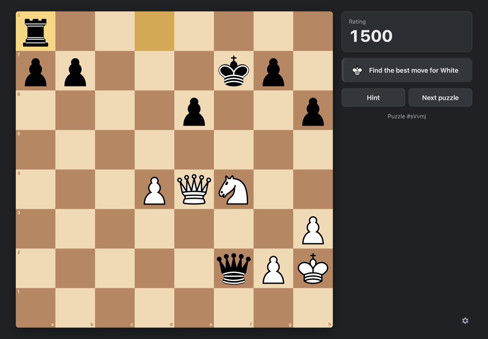

# Stalemate

Offline chess puzzles for Windows, macOS and Linux, built with Tauri 2 (Rust) and TypeScript.



**[Download Stalemate](https://github.com/yaotz1n/stalemate/releases/latest)** for Windows, macOS or Linux.

## Puzzle data

Puzzles come from the [Lichess puzzle database](https://database.lichess.org/#puzzles) (CC0). The app ships
`data/puzzles.db`, a filtered set of about 128k puzzles (28 MB) spread evenly across ratings 400–3000. To rebuild it:

```bash
curl -LO --output-dir data/raw https://database.lichess.org/lichess_db_puzzle.csv.zst
python3 tools/build_puzzle_db.py data/raw/lichess_db_puzzle.csv.zst
```

Options: `--target` (puzzle count, `0` = every puzzle that passes the filters, about 2.9M), `--min-popularity`,
`--min-plays`, `--max-rd`. `.zst` input needs `zstd` on PATH.

Each puzzle's FEN is the position *before* the opponent's move: `moves[0]` is played automatically, then the player
must find `moves[1]`, the opponent replies with `moves[2]`, and so on. Any checkmating move is accepted.

## Layout

| Path | What |
|---|---|
| `src-tauri/src/store.rs` | SQLite access: read-only `puzzles.db` + per-user `user.db` (attempts, rating, settings) |
| `src-tauri/src/glicko2.rs` | Glicko-2 rating updates (player vs. puzzle) |
| `src-tauri/src/lib.rs` | Tauri commands called from the frontend |
| `src/api.ts` | Frontend ↔ backend calls, with a mock for browser-only dev |
| `src/board.ts` | Board view: rendering, animation, click/drag input, promotion picker, arrows |
| `src/puzzle.ts` | Puzzle flow: opponent moves, checking answers, hints, solution, reporting results |
| `src/pieces.ts` | Piece sets (folders of piece images in `public/pieces/`) |
| `src/sounds.ts` | Sound packs (synthesized placeholders; file-based packs) |
| `src/settings.ts` | Board themes, animation speeds, difficulties, saved preferences |
| `tools/build_puzzle_db.py` | Builds `data/puzzles.db` from the Lichess CSV |

`user.db` lives in the OS app data folder (on macOS: `~/Library/Application Support/com.stalemate.app/`).

## Rules

- The first attempt at a puzzle is rated; a wrong move, a hint, or viewing the solution counts as a loss.
- Hint 1 highlights the piece to move; hint 2 draws the move as an arrow.
- Puzzles are picked from all themes, within about ±75 of your rating (widening if none are left).
- Keys: `H` hint, `N` next, `R` retry.

## Customizing

- **Board themes**: add an entry to `BOARD_THEMES` in `src/settings.ts`.
- **Pieces**: the board uses the Cburnett set from [Wikimedia Commons](https://commons.wikimedia.org/wiki/Category:SVG_chess_pieces)
  (BSD license, see `public/pieces/cburnett/LICENSE.txt`). Another set goes in `public/pieces/<name>/` as
  `wP.svg`, `wN.svg`, … `bK.svg`, loaded with `imageFolderSet(...)`.
- **Style** (Settings): *Classic* is the original look and synthesized sounds. *Arcade* adds piece lift/arc/land
  (knights hop), a board that builds out from the kings each puzzle and crumbles around a checkmated king, rising
  chimes for correct moves, a rolling rating counter, and recorded sounds. Arcade effects live in `.board.arcade`
  CSS and `Board.build/crumble/hop/land`; Classic never runs them.
- **Arcade sounds**: `public/sounds/arcade/*.wav`, Kenney CC0 packs (see `CREDITS.txt` there for the source file of
  each). To swap one, replace the `.wav` with the same name; the mapping is `arcadePack()` in `src/sounds.ts`.
